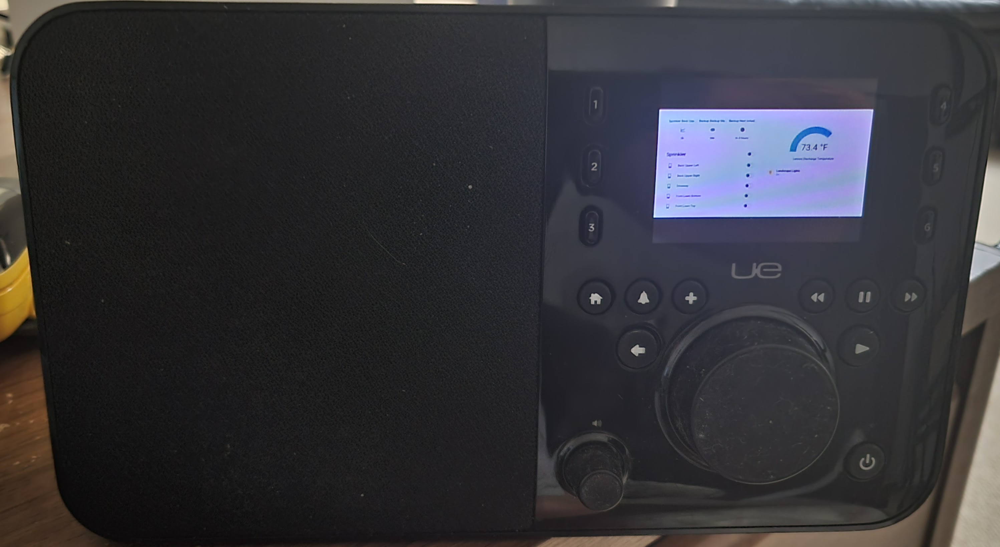

# MA-SqueezeliteBrowse

> **Important: if you downloaded `reinject.sh` before 12 October 2026**, your copy fetches the server files from an older branch that is no longer updated. Download `reinject.sh` again (step 2 under Usage) and run it; it always fetches the current files.

This patches the [Music Assistant](https://music-assistant.io/) Squeezelite provider so a Squeezelite client (e.g. a Logitech Media Server-style client, or [piCorePlayer](https://www.picoreplayer.org/)) can **browse the Music Assistant media library directly from the client**, instead of only playing whatever Music Assistant pushes to it.

Browsing isn't the only thing it changes. It also fixes a number of existing issues with how the stock provider pushes content to the client:

- Seek fwd/back either drag via touch or button
- Stream/track detail display
- Shuffle/repeat button sync with Music Assistant
- Queue display and track management (add/remove/reorder) sync with the server
- Power on/off from the device, including resume on power on and powering on at connect
- Presets under My Music

It also includes experimental changes to integrate media and non media related Home Assistant items (scenes, sensors, switches). These also register screensavers on the devices showing camera(s) and dashboard(s). See Experimental Proof Of Concept below.

[Menu walkthrough](docs/MA-SqueezeliteBrowse-menu-walkthrough.pdf) (PDF, 29 pages): screenshots of the menus on a piCorePlayer, from the main menu through My Music, Now Playing and the queue, Settings and HA Extras.

It works by injecting patched provider files and a patched `aioslimproto` package straight into the running `music_assistant` container's Python environment.

The intent is to let you quickly test these changes against your own real Music Assistant setup and real Squeezebox-style clients, without needing a full Music Assistant development environment. If you'd rather develop that way - editing the real source, running the test suite, etc. - use the forked repositories directly (see below). This script is for the "I just want to try it" path: from a stock Home Assistant host with Music Assistant already running, you can be testing in a few minutes.

## Where the actual code lives

The patched source itself isn't in this repo - it lives in two forks: `aioslimproto` on a `ma-squeezelite-browse` branch based on upstream `main`, and `server` on a `dev-squeezelite-browse` branch based on upstream `dev`:

- [lawrence-jeff/aioslimproto](https://github.com/lawrence-jeff/aioslimproto/tree/ma-squeezelite-browse) - the `aioslimproto` package (`cli.py`, `client.py`, `models.py`, `server.py`).
- [lawrence-jeff/server](https://github.com/lawrence-jeff/server/tree/dev-squeezelite-browse) - `music_assistant/providers/squeezelite/` (`provider.py`, `browselibrary.py`, `player.py`, `strings.json`, `haextras.py` for the experimental HA Extras, and the `static/` menu icons), with its unit tests in `tests/providers/squeezelite/` and the setting text in `music_assistant/translations/en.json`. The branch is built on Music Assistant's `dev`, which is ahead of the latest release.

This repo holds only `reinject.sh` and this README. `reinject.sh` downloads the files it needs from those two branches itself (see Usage below) - there's nothing to clone or set up by hand.

## How it works

- `reinject.sh` - downloads the patched `aioslimproto` files and the squeezelite provider files (plus `static/`) from the two forks above into `/config/ma-squeezelite-browse`, copies them into the running Music Assistant container, verifies the patches landed, and restarts the container so they take effect.

## Requirements

- Music Assistant **2.10.5 or later**, due to a dependency on `aioslimproto` 3.2.3. Tested on 2.10.5 and 2.10.6. The server files come from a branch built on Music Assistant's `dev`, which is ahead of the release, so if `dev` changes the Squeezelite provider or the core code it uses, a fresh download may stop matching an older release.
- Home Assistant running Music Assistant as an add-on/container.
- SSH access to Home Assistant **with Docker access** — the [Advanced SSH & Web Terminal](https://github.com/hassio-addons/addon-ssh) add-on works well for this.
- `docker` and `curl` available in that SSH session.
- A writable `/config` directory - only needs to hold the handful of downloaded patch files (well under 2MB total).
- Optional, only if you want `reinject.sh` to also reboot a real Squeezebox (e.g. a UE Radio) test client over SSH: `sshpass`, installed yourself beforehand (`apk add sshpass` on the Home Assistant OS's own Alpine-based SSH session). `reinject.sh` deliberately does **not** install this automatically — it's your call whether to add packages to your own Home Assistant host, not something this script should decide on your behalf. If `sshpass` isn't installed, that reboot step is skipped with a warning; everything else still runs normally.
- Optional, to see or control Home Assistant entities on the device: Music Assistant's Home Assistant plugin, the `HA Extras` label on the entities, and, for dashboards, a screenshot add-on. See [Experimental Proof Of Concept](#experimental-proof-of-concept) below.

## Usage

1. SSH into Home Assistant using an add-on that gives you Docker access (Advanced SSH & Web Terminal is confirmed to work).
2. Download `reinject.sh` (it uses absolute paths throughout, so it doesn't matter where you put it - your home directory is fine):
   ```
   curl -fsSL https://raw.githubusercontent.com/lawrence-jeff/MA-SqueezeliteBrowse/main/reinject.sh -o reinject.sh
   chmod +x reinject.sh
   ```
3. If you're testing against a piCorePlayer client, `reinject.sh` includes a line that reboots it after patching:
   ```
   curl -s "http://192.168.0.241/cgi-bin/main.cgi?ACTION=reboot" > /dev/null
   ```
   Update the IP to your client, or remove the line if you don't need the client rebooted after each run. A change that only touches the server does not need the reboot (the clients reconnect when Music Assistant restarts): run `SKIP_CLIENT_REBOOT=1 ./reinject.sh` to leave both the piCorePlayer and any other client running.
4. If you're also testing against a real Squeezebox device (e.g. a UE Radio) on the same network, `reinject.sh` includes a second, separate best-effort step that reboots it over SSH afterward. The device must have **Remote Access** (sometimes called SSH/remote support access) enabled in its own on-device Settings menu first, or the SSH connection will simply fail/time out regardless of the credentials/algorithm overrides below.
   ```
   sshpass -p '1234' ssh -oKexAlgorithms=+diffie-hellman-group1-sha1 -oHostKeyAlgorithms=+ssh-rsa -oCiphers=+aes256-cbc -oMACs=+hmac-sha1 root@192.168.0.242 reboot
   ```
   Real Squeezebox firmware only offers key-exchange/host-key/cipher/MAC algorithms modern OpenSSH disables by default, which is why those four `-o` overrides are there — adjust them if a different device offers a different set (the error message when connecting without one of these tells you exactly which category and which algorithm it's missing). Update the IP/password to your own device, or remove the step if you don't have one. This step needs `sshpass` (see Requirements above) and is skipped automatically if it's not installed. Note: this device's own SSH server has been observed to report a non-zero/error exit even when the command fully succeeded — if this step prints a warning, check whether the device actually rebooted before assuming it's broken.
5. Run it:
   ```
   ./reinject.sh
   ```
   `reinject.sh` auto-detects your Music Assistant container. Every run first fetches the current patch files straight from the branches of the two forks (no git, no full clone) into `/config/ma-squeezelite-browse`, replacing what is there (a failed download changes nothing), copies them into the container, verifies each patched file landed in the container by comparing checksums (it fails loudly if any differ), confirms the provider module still imports cleanly, and restarts the container so Music Assistant picks up the changes.
6. Plain `./reinject.sh` always downloads the latest files, so running it again later picks up newer patches. `./reinject.sh -local` skips the download and injects the files already in `/config/ma-squeezelite-browse` instead - for working offline, or for files you copied there yourself while developing.

   Consider disabling Music Assistant's Auto Update while you're testing this. An auto-update - or any restart of the app that recreates the container - reverts back to stock (see below) and means running `reinject.sh` again.

## Experimental Proof Of Concept

Things here go beyond browsing and playing music. They are experiments to see what Squeezebox-style clients can do when the server drives their menus, and they may not belong in Music Assistant itself.

### HA Extras: Home Assistant on the device

An **HA Extras** entry under Settings (with a Home Assistant icon) shows Home Assistant entities on the device. It uses Music Assistant's own Home Assistant plugin for the connection and login, so there is no connection to configure, and it does not appear when that plugin is not set up.

Only entities that carry the Home Assistant **label** named `HA Extras` are shown or controllable. Create the label in Home Assistant (Settings > Areas, labels & zones > Labels) and add it to the entities you want to make visible or controllable.

Each device also needs a checkbox. In Music Assistant, open the player's settings, tick **Expose HA Entities to Device (HA Extras)** (under Output protocol), and restart the device so it reloads its menu. It is off by default, so devices without it get no HA Extras and their requests are refused.

HA Extras has these panels:

- **Cameras**: choosing a camera shows a snapshot full screen in the Image Viewer. It fetches a new snapshot about every 10 seconds (the Image Viewer's delay setting) until you press a key.
- **Dashboards**: Home Assistant cannot put a label on a dashboard, so a labeled entity stands in for it: a template sensor (Settings > Devices & services > Helpers > Template > Sensor) whose name is the title and whose state is the address of a picture of the dashboard. A screenshot service renders that picture; the Puppet Home Assistant add-on is what this was tried with, for example `http://<host>:10000/lovelace/3?viewport=1920x1080&format=jpeg`. Choosing the entry shows it full screen and refreshes like the cameras.
- **Controls**: lights, switches, input booleans, fans and media players (a receiver or TV). Each row shows the name and its state, and choosing it opens a menu with **Turn On**, **Turn Off** and **Cancel**.
- **Scenes and Scripts**: choosing one opens a menu with **Run** and **Cancel**.
- **Status**: every other labeled entity as read-only rows (name, then the value with its unit; numbers are rounded to one decimal).

All Cameras and Dashboards also register as screensaver providers, so you can configure the device to show a fixed one (10 sec refresh) or rotate through them every 10 seconds.

World's smallest HA dashboard running as a screensaver on old Squeezebox UE




Notes:

- It is limited to turning things on and off and running scenes. Brightness, colors, locks, covers and climate controls are not handled.

## Reverting back to stock

The patch is applied directly to the container's filesystem, so it survives a plain container restart (which is what `reinject.sh` does at the end). It is **not** persistent across:

- Restarting the Music Assistant add-on/integration from the Home Assistant UI in a way that recreates the container, or
- Updating Music Assistant to a new version/image.

Either of those resets the container back to the stock image, so you'll need to run `reinject.sh` again afterward.

## Reporting issues

Please open issues in **this repo**, not the forked `aioslimproto`/`server` repos - even if the bug turns out to live in one of them. That lets them stay triaged in one place; the right fork gets fixed from there.
